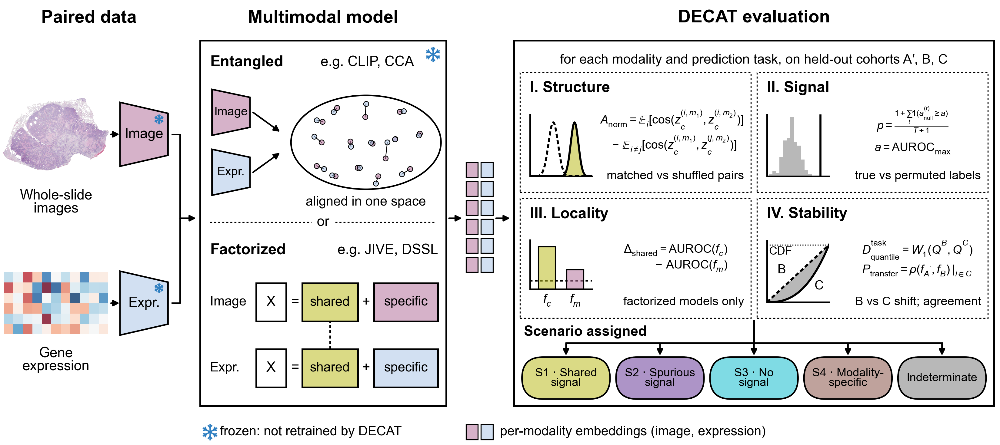

# DECAT: Diagnostic Evaluation of Cross-modal Alignment and Transfer

Code for **"When Are Multimodal Predictions Biologically Supported? A Diagnostic Evaluation Framework"** (NeurIPS 2026, Evaluations & Datasets Track).

DECAT is a model-agnostic, post-hoc evaluation framework that classifies the predictive behavior of a multimodal representation, for a given task and modality, into four diagnostic scenarios without requiring knowledge of which putative confounder is present.



*DECAT takes per-modality embeddings from any multimodal model and uses a four-stage decision procedure to classify the predictive behavior of each modality, for a given task, into one of four scenarios or indeterminate.*

> **Intended use.** DECAT is a model diagnostic for assessing whether learned representations support biological interpretation before downstream use. It does not make clinical decisions or generate patient-level predictions. A Scenario 1 verdict is not a certification of biological validity; DECAT's output should be interpreted as one component of a broader model validation strategy (see the paper's Broader Impacts).

---

## Diagnostic Scenarios

| Scenario | Meaning |
|----------|---------|
| **S1 — Shared signal** | Predictive signal is also independently observable in the other modality and transfers stably across cohorts; consistent with shared biology, not proof of a shared mechanism |
| **S2 — Spurious signal** | Predictive signal transfers across cohorts but is composition-unstable, consistent with batch effects, site-specific artifacts, or proxy features |
| **S3 — No signal** | The representation carries no task-relevant information |
| **S4 — Modality-specific signal** | Stable predictive signal that is not independently observable in the other modality |
| **Indeterminate** | Evidence is insufficient to assign a scenario |

DECAT uses five null-referenced metrics (A_norm, B_norm, Δ_shared, P_transfer, D^task_quantile) and a fixed four-stage decision procedure with no learned parameters. A verdict other than S2 is not evidence that a signal is biological: S2 is detectable only when the cohort shift between B and C has a component along the outcome-predictive direction, so a putative confounder can go undetected if it is weak relative to the sample size or orthogonal to the shift.

---

## Repository Structure

```
├── simulator/          # Synthetic data generator
├── models/             # CCA, CLIP, JIVE, DisentangledSSL
├── metrics/            # A_norm, B_norm, Δ_shared, P_transfer, D_quantile
├── decision/           # Rule-based scenario classifier
├── evaluation/         # Linear probes, bootstrap utilities
├── pipeline/           # End-to-end train + evaluate pipeline
├── analysis/           # Metrics summary, plotting utilities
├── experiments/
│   ├── ablation_study.py                  # Decision-tree ablation (appendix table)
│   ├── synthetic/
│   │   ├── run_pre_step_a.py              # Alignment saturation calibration
│   │   ├── run_pre_step_a2.py             # Epoch convergence validation
│   │   ├── run_main_experiment.py         # Main synthetic experiment
│   │   ├── run_nonlinear_experiment.py    # Nonlinear measurement / batch conditions
│   │   └── run_batch_align_ablation.py    # ρ_b sweep
│   └── tcga_validation/
│       ├── prepare_data.py                # Data preparation
│       ├── prepare_mc3_data.py            # MC3 driver-mutation matrix
│       ├── train_models.py                # Train multimodal models on TCGA
│       ├── run_decat.py                   # Run DECAT on TCGA
│       ├── run_pipeline.py                # prepare → train → evaluate → power curve
│       ├── run_alpha_mixture_sweep.py     # α-mixture sweep (TMB/Age, value-threshold E)
│       ├── run_alpha_mixture_sweep_probe_e.py      # α-mixture sweep (TP53, probe-score E)
│       ├── run_unimodal_fm_comparison.py           # Unimodal H&E FM evaluation
│       ├── run_unimodal_alpha_mixture_probe_e.py   # Driver-gene α-sweep
│       ├── run_driver_gene_collapse.py    # Within-cancer-type AUROC collapse
│       ├── run_power_curve.py             # Power curve
│       ├── run_within_ct_decat.py         # Within-BRCA DECAT
│       ├── run_within_ct_collapse.py      # Within-BRCA per-stratum AUROC collapse
│       └── run_tss_enrichment.py          # TSS enrichment of the extreme pool
├── examples/
│   └── quickstart.py                      # DECAT on synthetic embeddings (S1 and S2)
├── notebooks/manuscript/
│   ├── manuscript_figures.ipynb           # All manuscript figures
│   ├── ablation_study.ipynb               # Appendix tables (one notebook each)
│   ├── nonlinear_experiment.ipynb
│   ├── batch_align_ablation.ipynb
│   ├── indeterminate_rates.ipynb
│   ├── within_ct_confounding.ipynb
│   └── tss_site_confounding.ipynb
├── tests/
├── requirements.txt
└── LICENSE
```

---

## Reproducing the Figures and Tables

### Requirements

Python ≥ 3.11.

```bash
pip install -r requirements.txt
```

### Data

The precomputed results needed by the notebooks are distributed as `data.tar.xz`, attached to the GitHub Release. Extract it at the repository root:

```bash
tar -xf data.tar.xz   # creates data/
```

No raw embeddings, genomic data, or clinical downloads are required to reproduce the figures and tables. Patient-level clinical and mutation tables are not distributed. Two cached intermediates (`alpha_mixture_collapse_cache.csv`, `pan_cancer_within_tss_auroc_collapse.csv`) are included so the notebooks run without them; regenerating these requires the patient-level clinical, mutation, and embedding data produced by the TCGA pipeline. To re-run the TCGA pipelines from scratch, whole-slide images, bulk RNA-seq, and clinical data are available from the Genomic Data Commons (GDC), and somatic mutation labels are derived from the MC3 consensus callset (`mc3.v0.2.8.PUBLIC.maf.gz`). Foundation-model weights are distributed by their authors; some require access approval.

RNA-seq embeddings were produced with the Clinical Transformer (Arango-Argoty et al., *Nature Communications*, 2025; code: https://codeocean.com/capsule/2256163/tree/v1). The pretrained weights used here are not publicly available. The embedding extraction (log2(TPM+1) input restricted to expressed genes, per-sample robust z-score, [CLS] hidden state, 1024-dim) is described in the paper's appendix. See [Running Experiments](#running-experiments).

Each notebook sets `DATA_DIR = Path('../../data')` in its first code cell. Change it if you extract the archive elsewhere.

### Running the Notebooks

```bash
jupyter notebook notebooks/manuscript/manuscript_figures.ipynb
```

Run all cells in order. Figures are saved to `figures/manuscript/`. Each appendix-table notebook prints its table.

---

## Using DECAT on Your Own Embeddings

DECAT needs per-modality embeddings and binary task labels for three cohorts:

- **A′**: a within-distribution evaluation cohort.
- **B** and **C**: two further cohorts. S2 is detected through the shift between B and C, so C should differ from B in composition, e.g. a different site or a cohort enriched for a putative confounder.

In the paper's TCGA experiments, A′ and B are random splits of the study population and C is drawn from an extreme pool E (Section 4.2).

Only `numpy`, `scipy`, `scikit-learn`, and `joblib` are needed for this (`torch` is only used to train the multimodal models). A runnable example on synthetic data is in `examples/quickstart.py`.

The per-(model, task) evaluation used for the TCGA results is `_evaluate_one` in `experiments/tcga_validation/run_decat.py`. Run from the repository root:

```python
import sys
sys.path.insert(0, 'experiments/tcga_validation')
from run_decat import _evaluate_one

records = _evaluate_one(
    split_id=0, split_type='custom', model_name='my_model',
    is_factorized=False, gamma=None,
    Zh={'Ap': zh_ap, 'B': zh_b, 'C': zh_c},   # modality 1 (e.g. H&E), shape (n, d)
    Zr={'Ap': zr_ap, 'B': zr_b, 'C': zr_c},   # modality 2 (e.g. RNA-seq)
    y_ap=y_ap, y_b=y_b, y_c=y_c,              # binary labels; -1 marks missing
    task_type='my_task', task_idx=0, seed=0,
)
for r in records:                             # one record per modality
    print(r['modality'], r['predicted_scenario'])
```

Each record contains the verdict and every metric with its null threshold (`anorm`/`anorm_null_upper`, `transfer_ci_lower`/`transfer_null_upper`, `dquantile_task`/`dquantile_task_null_upper`, and the Δ_shared bounds for factorized models), so an Indeterminate verdict can be traced to the stage that did not resolve. For factorized models (JIVE, DisentangledSSL), pass `is_factorized=True` and `gamma`, the per-dimension sharedness scores of shape `(K,)` used to split each embedding into shared and modality-specific parts. Labels for C are only used to report AUROC on C, not by the decision procedure.

---

## Running Experiments

### Synthetic Experiment

```bash
# Pre-experiment calibration (alignment saturation, epoch convergence)
python experiments/synthetic/run_pre_step_a.py
python experiments/synthetic/run_pre_step_a2.py

# Main experiment (365 runs × 7 models, ~22 h on 8 GPUs)
python experiments/synthetic/run_main_experiment.py

# Robustness experiments (appendix)
python experiments/synthetic/run_nonlinear_experiment.py
python experiments/synthetic/run_batch_align_ablation.py
```

### TCGA Validation

Steps 1–3 are required; steps 4–7 produce the remaining manuscript figures.

```bash
# 1. Prepare data (slide-level FM embedding CSV with USUBJID + E* columns)
python experiments/tcga_validation/prepare_data.py \
    --he-csv /path/to/titan_20x.csv \
    --out-dir /path/to/output

# 2. Train multimodal models (requires GPU)
python experiments/tcga_validation/train_models.py --out-dir /path/to/output

# 3. Run DECAT evaluation
python experiments/tcga_validation/run_decat.py --out-dir /path/to/output

# 4. Unimodal H&E FM comparison
python experiments/tcga_validation/run_unimodal_fm_comparison.py --out-dir /path/to/output

# 5. α-mixture sweeps
python experiments/tcga_validation/run_alpha_mixture_sweep_probe_e.py \
    --out-dir /path/to/output --models clip_K50          # TP53, probe-score E
python experiments/tcga_validation/run_alpha_mixture_sweep.py \
    --out-dir /path/to/output                            # TMB / Age, value-threshold E

# 6. Driver-gene α-sweep
python experiments/tcga_validation/run_unimodal_alpha_mixture_probe_e.py --out-dir /path/to/output

# 7. Power curve
python experiments/tcga_validation/run_power_curve.py --out-dir /path/to/output

# Or run steps 1–3 and 7 in sequence
python experiments/tcga_validation/run_pipeline.py --out-dir /path/to/output
```

### Environment Variables

Input and output locations are read from environment variables. Defaults are relative to the repository root: outputs go under `./data/` (matching the layout of `data.tar.xz`), and raw inputs are expected under `./data/embeddings/pathology/` and `./data/embeddings/rna/`.

| Variable | Controls |
|----------|----------|
| `DECAT_RESULTS_DIR` | Synthetic experiment outputs |
| `DECAT_NONLINEAR_DIR` | Nonlinear experiment outputs |
| `DECAT_BATCH_ALIGN_DIR` | ρ_b sweep outputs |
| `DECAT_OUT_DIR` | TCGA validation outputs and representations |
| `DECAT_DATA_DIR` | FM embedding CSVs (one subdirectory per FM) |
| `DECAT_CLINICAL_CSV` | TCGA clinical metadata |
| `DECAT_MUTATION_CSV` | MC3 driver-gene mutation matrix |
| `DECAT_TMB_CSV` | Tumor mutational burden |
| `DECAT_RNA_CSV` | RNA-seq embeddings (`prepare_data.py`, `run_pipeline.py`) |

---

## Citation

```bibtex
@inproceedings{steiner2026decat,
  title     = {When Are Multimodal Predictions Biologically Supported? A Diagnostic Evaluation Framework},
  author    = {Steiner, Dylan and Arango-Argoty, Gustavo and Sun, Gerald and Jacob, Etai},
  booktitle = {Advances in Neural Information Processing Systems (Evaluations and Datasets Track)},
  year      = {2026}
}
```

## License

Copyright 2026 AstraZeneca. Licensed under the Apache License 2.0. See [LICENSE](LICENSE).
